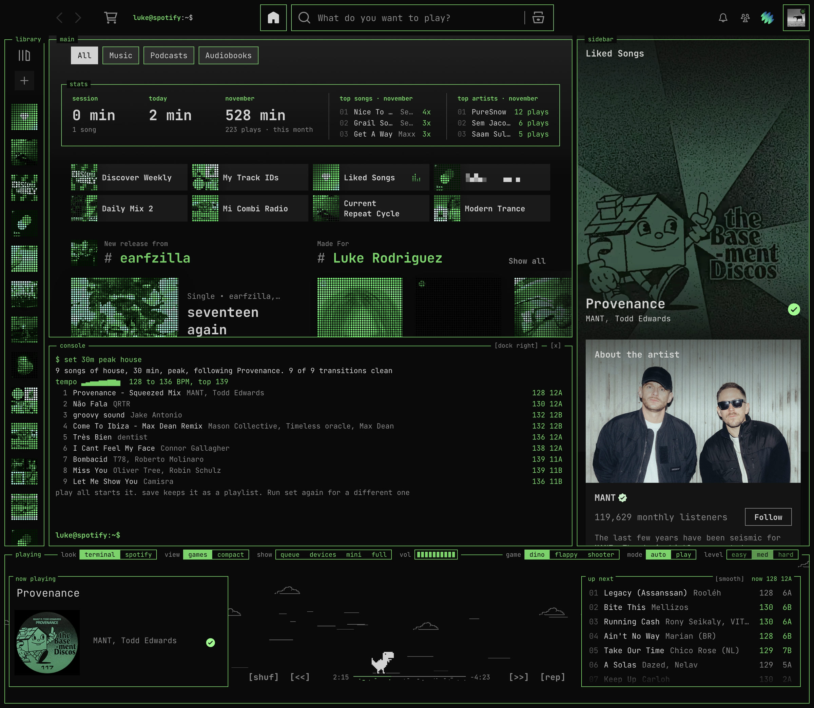
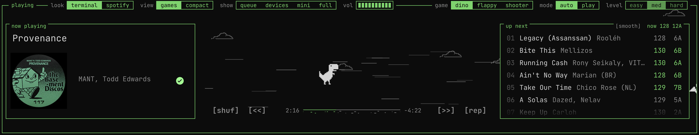
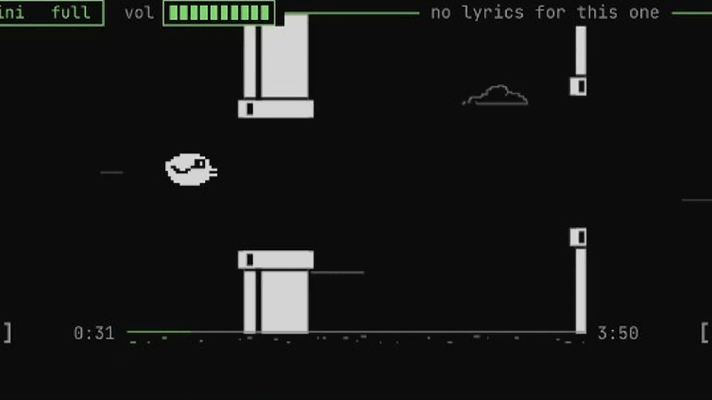
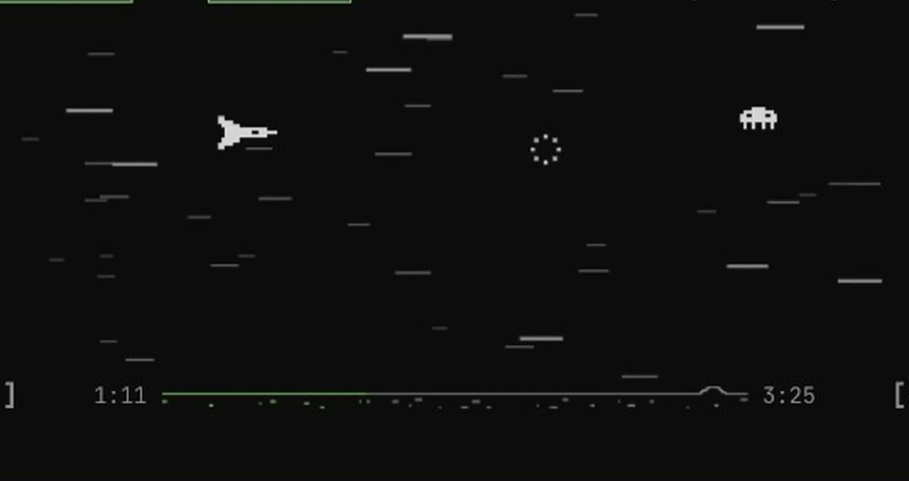
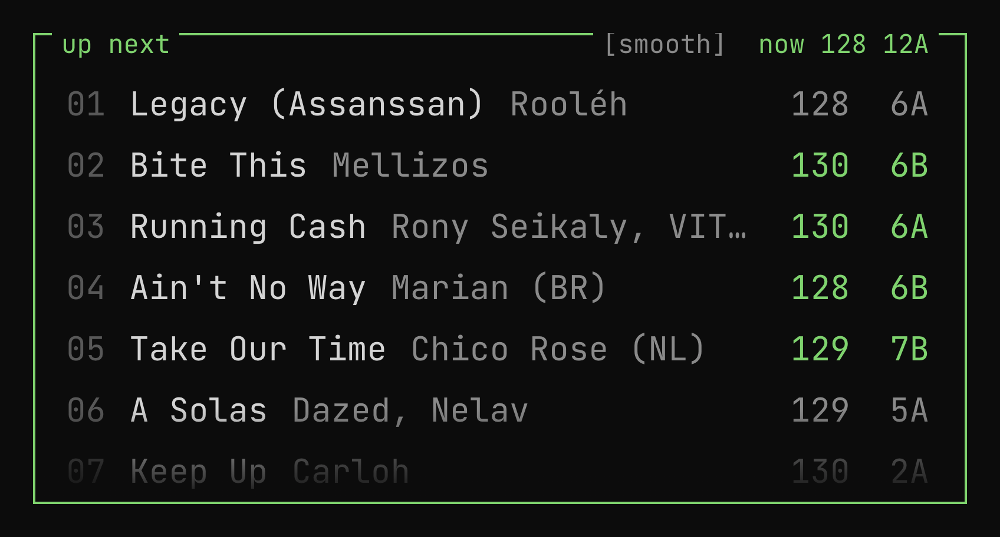
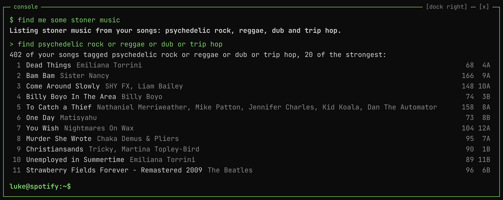
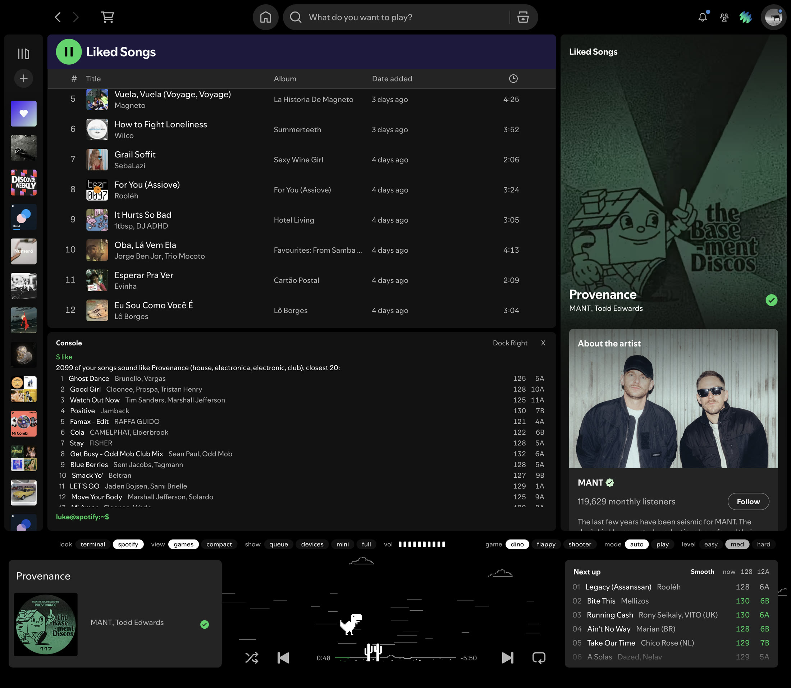
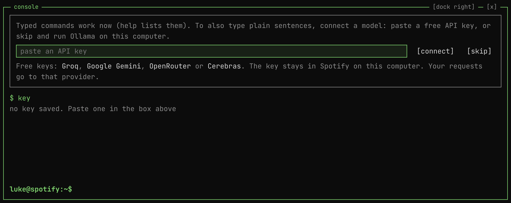

# Spotify Minigame UI

I put the Chrome dinosaur on Spotify's progress bar… and then I couldn't stop.



Developed by [@iamtava](https://x.com/iamtava) on X and [@tava](https://instagram.com/tava) on Instagram.

## How this started

It started as a procrastination thing. I restyled the Spotify desktop app to look like a terminal (monospace everything, green borders, album art in green halftone), and then I looked at the progress bar. It's the thing I stare at most in the whole app and it does exactly one job. So I put the no-wifi dinosaur on it.

Then he needed to jump on the beat. Then I wanted my queue to flow like a DJ set. Then I wanted to just type "play some stoner music" and have it work.

That's pretty much the whole roadmap. It's a mod for the Spotify desktop app, it's free, and it installs in a few minutes.

## What you get

### Three games that play along with your music



The playback bar is the ground. The song is the level.

- **Dino, flappy and a shooter.** Switch between them on the bar's top border.
- **Everything lands on the beat.** Cacti show up so the dino takes off exactly on a beat. Flappy's gravity follows the tempo, so you end up flapping in time without anyone telling you to. The shooter's gun fires on the beat and the aliens march to it.
- **Watch or play.** On watch it plays itself and the difficulty follows the song's BPM. On play it's yours… `↑` jumps or flaps, `↓` ducks, and you pick the level.
- **Crashing pauses your song.** Which is a genuinely rude thing for software to do, and I love it.

| Flappy | Shooter |
|---|---|
|  |  |

### A queue that knows tempo and key



Every song in up next shows its BPM and its key on the Camelot wheel (the thing DJs use to tell which songs blend). The numbers light up green when a song mixes cleanly with the one before it.

Hit `[smooth]` and it reorders your next 30 songs so the tempos and keys run into each other. It works on any queue… an album, someone else's playlist, radio. Click again to undo.

Bored of the vibe? Hit `[shift]`. It picks a genre from your own songs that's nothing like what's playing, at random, and queues six of them to play next, starting with the one that mixes best out of the current song. Click again to take them back out.

### A console you can just talk to



Click the prompt in the top bar, or press the backtick key. Then type what you want.

- `play some deep house`
- `something chill to work to`
- `play songs like Mi Combi that mix well with it`
- `find new music like this`
- `build me an hour set that climbs, and save it as friday`
- `DJ for me for an hour, start with deep house and end on techno`
- `go back to what I was listening to`

It figures out the genre, the mood or the vibe ("stoner music" turns into psychedelic rock, reggae, dub and trip hop), finds the songs, and plays them. It remembers the conversation, so you can answer "yes, call it warehouse" when it offers to save a playlist.

The console is a real pane, not a pop-up. Drag its title to dock it under or beside the main view, and drag its edge to resize it.

### Sets

`set 60m peak house` builds an hour of your house music that starts from whatever's playing, climbs in tempo, peaks, and eases off… with every song picked to mix into the next one. `save` turns it into a real playlist you can open in Spotify's own Mix feature or a DJ app.

### An AI DJ

`dj 90 minutes, start with deep house, build to techno` and it does what a DJ does. It plans the set in phases (genres, tempo, how long the blends should be), picks songs from your library that fit each phase and mix into each other, and writes a transition for every pair: where to leave one song, where to bring in the next, and for how many bars. Then it presses play, and Spotify's own mixing engine performs it, beatmatched.

`dj plan …` shows you the plan without playing anything. `dj keep friday` keeps the set as its own playlist, transitions included. `undo` puts your music back.

You can also plan a set somewhere else. `export` saves your songs with their tempo, key, tags and release year as one file. Hand that to any AI (or plan it yourself, if you're that kind of person), have it write a set file in the format in [dev/SET-FORMAT.md](dev/SET-FORMAT.md), and paste it after `dj load`. It mixes and plays the set with the cue points and blend lengths the file asks for, snapped to Spotify's beat grid. The set can use any song on Spotify, not only yours. `dj check` shows it first without playing anything. `dj audition` plays only the transitions, about 40 seconds each, so you can check an hour of mixing in a few minutes.

(This one needs Spotify Premium, since it runs on Spotify's Mix feature.)

### Two looks



If the terminal thing isn't your vibe, open ⚙ settings on the bar's top border and pick Spotify. Same layout, same games, same console, in Spotify's normal look. The same menu turns the games off.

There's also lyrics running one line at a time along the top border, listening stats on Home, and a compact view with no games for when you need to act like an adult.

## Install

You need the Spotify desktop app and [Spicetify](https://spicetify.app), which is the tool that lets you mod it.

### The easy way: have an AI assistant do it

Paste this into an AI coding assistant that can run commands on your computer:

```text
Install the Spotify Minigame UI theme on my computer:

1. Install Spicetify if it isn't installed:
   - macOS or Linux: curl -fsSL https://raw.githubusercontent.com/spicetify/cli/main/install.sh | sh
   - Windows (PowerShell): iwr -useb https://raw.githubusercontent.com/spicetify/cli/main/install.ps1 | iex
   If Spotify on Windows came from the Microsoft Store, stop and tell me to reinstall it from spotify.com first.
2. Clone https://github.com/luketavarodriguez/spotify-minigame-ui into the Spicetify Themes folder as "spotify-minigame-ui"
   (~/.config/spicetify/Themes on macOS and Linux, %APPDATA%\spicetify\Themes on Windows).
3. Run: spicetify config current_theme spotify-minigame-ui color_scheme tty inject_theme_js 1 inject_css 1 replace_colors 1
4. Run: spicetify backup apply (or spicetify apply if a backup already exists).
5. Tell me when it's done. Spotify will restart with the theme on.
```

### By hand

1. Install [Spicetify](https://spicetify.app/docs/getting-started).
2. Clone this repo into your Spicetify Themes folder:
   - macOS and Linux: `~/.config/spicetify/Themes`
   - Windows: `%APPDATA%\spicetify\Themes`

   ```bash
   git clone https://github.com/luketavarodriguez/spotify-minigame-ui ~/.config/spicetify/Themes/spotify-minigame-ui
   ```

3. Turn it on:

   ```bash
   spicetify config current_theme spotify-minigame-ui color_scheme tty inject_theme_js 1 inject_css 1 replace_colors 1
   spicetify backup apply
   ```

   The first time, use `spicetify backup apply`. After that, `spicetify apply` is enough.

Color schemes: `tty` (default), `amber` and `green`. Switch with `spicetify config color_scheme amber && spicetify apply`.

## Your first five minutes

1. **Press play on anything.** The dino starts running.
2. **Give it a minute.** It's quietly indexing your Liked Songs (tempo, key, genre). About a minute for 6,000 songs.
3. **Press the backtick key** to open the console.
4. **Connect a model** so you can type plain sentences. More on that right below.
5. **Type `play some` and a genre you like.**

## Connecting a model

Typed commands work on their own. To type plain sentences, the console needs a language model to translate them. You've got two options.

### A free API key (nothing to install)



The first time you open the console, it asks for a key. Grab one from any of these, paste it in, and press connect:

- [Groq](https://console.groq.com/keys) (the one I'd start with)
- [Google Gemini](https://aistudio.google.com/apikey)
- [OpenRouter](https://openrouter.ai/keys), which uses its free models
- [Cerebras](https://cloud.cerebras.ai)

Each has a free tier at the time of writing, with daily limits that are plenty for a music console. `key` brings the box back later, and `key remove` disconnects.

A few things you should know before you paste a key:

- **Where the key lives:** in Spotify's own storage on your computer, unencrypted. It only gets sent to the provider it belongs to.
- **What the provider sees:** your sentence, the playing song's name, tempo and key, the genre names in your library, and the first few songs of the last list. Not your whole library… and nothing at all when you use typed commands.
- **Another server:** anything that speaks the OpenAI chat format works. Paste its address, a space, then the key, like `https://example.com/v1 my-key`.

### Ollama, on your own computer

This is what I use. Nothing you type leaves your machine. Install [Ollama](https://ollama.com) and pull a model:

```bash
ollama pull qwen3:8b
```

Ollama refuses requests from pages it hasn't been told about, and Spotify's interface is one of them. On macOS, allow it from the theme's folder:

```bash
sh ollama-allow.sh install
```

That sticks across restarts. `sh ollama-allow.sh remove` undoes it. On other systems, set `OLLAMA_ORIGINS` to `https://xpui.app.spotify.com` and restart Ollama.

If a key is saved, the console uses it. Without one, it uses Ollama.

One gotcha… Ollama answers one request at a time. If something else on your computer keeps it busy, the console waits in line (and gives up after a minute). `sh ollama-console.sh install` runs a second Ollama that only the console uses. It costs about 6 GB of memory while its model is loaded.

## Everything you can type

You don't need to memorize any of this (that's the point of plain words), but every command works on its own with no model connected.

| Type | What happens |
|---|---|
| `find deep house` | Your songs by genre or mood. Add a tempo, key or name: `find techno 130-140bpm`, `find 124bpm 8A` |
| `find party` | Occasions work too: party, workout, study, sleep, relax, dinner |
| `find reggae or dub` | Any of several genres |
| `find 2018` | Songs you added that year |
| `find 90s` | Songs released in the 90s. `find house 90s`, `find 1995-1999` and `find released 2018` work too |
| `… in my track ids` | End `find`, `mix`, `like` or `set` with a playlist to look only there. Also `in liked` and `in library` |
| `search daft punk` | Any song on Spotify, by title or artist |
| `mix` | Your songs that mix cleanly with the one playing. Also `mix slower`, `mix faster`, `mix techno` |
| `like` | Your songs that sound like the one playing. `like mix` also matches key and tempo. Or name any song: `like blue monday` |
| `radio` | New songs like this one from all of Spotify. `radio mix` keeps the ones that blend |
| `set 60m peak` | Build a set. Shapes: flat, up, down, peak. Add a genre or a playlist |
| `dj <brief>` | Plan, mix and play a DJ set with real transitions. `dj plan <brief>` only shows it, `dj keep <name>` keeps it |
| `dj load <set>` | Play a set file another app or AI wrote. `dj check <set>` only shows it |
| `dj audition` | Play only the transitions of the set you just loaded |
| `export` | Save your songs, with tempo, key and tags, as a file to plan sets elsewhere |
| `play all` / `play 3` | Play the last list, or one song from it |
| `add 1 3 5` | Queue songs from the last list. Clicking a row does the same |
| `undo` | Take back the last play, add or smooth. Your song, your place in it and your queue come back |
| `smooth` | Reorder the next 30 songs so they flow |
| `save friday` | Save the last list as a playlist |
| `top` | Your most played this month |
| `shift` | Change the vibe: six songs from a random different genre, queued next |
| `log` | The last songs played, finished or skipped. `log skips` for just the skips |
| `genres` / `playlists` | What you've got to work with |
| `now` | The playing song's tempo, key and tags |
| `key` / `model` | Connect a model, or see which one is answering |
| `help` | All of the above, inside the console |

"Your songs" means your Liked Songs plus the playlists you made. They get read in the background the first time you use the console (about 20 seconds for 200 playlists).

## What it can't do

It's not a magic button. Honestly, a few things will trip you up:

- **Spotify updates wipe it.** Every update removes the mod, and you run `spicetify upgrade` then `spicetify backup apply` to get it back. On macOS, [self-repair](#self-repair-on-macos) does that for you. That's the deal with modding someone else's app… it's yours until their next update.
- **I've only tested it on macOS.** Spotify 1.3.9 with Spicetify 2.46.7. The theme itself is plain CSS and JavaScript, so it should run on Windows and Linux, but I haven't tried. `self-repair.sh` and the two Ollama scripts are macOS only.
- **The genre tags are Spotify's, and some are wrong.** A rap song can show up tagged "new age". Kind of funny, mostly harmless.
- **Some tempos read double.** A song at 87 BPM might say 174. The mixing logic treats those as the same tempo, so it still works.
- **The model makes mistakes.** A small local model will sometimes pick the wrong command. It can only run the commands in the table above, so the worst case is the wrong songs… and `undo` fixes that.
- **It doesn't know your favorites.** There's no play history beyond the current month and no lyrics search. Ask for "my favorite song from 2018" and it will tell you it can't know, then play something you added in 2018.
- **A set file is only as good as whoever wrote it.** It can't hear the songs either. If it names a song by the wrong id, the console warns you but still plays whatever that id is. Cue points that don't fit the songs fall back to Spotify's own mix, and the console tells you which.
- **Songs without beat data** (podcasts, local files, a few tracks) play the games without beat sync.

## Under the hood

For the curious.

**It doesn't break the way most Spotify mods do.** Most Spicetify themes style Spotify through Spicetify's class-name map, which Spotify scrambles on every update. This one finds its way around with labels Spotify builds in for itself (test IDs like `now-playing-bar`, element IDs like `main-view`, accessibility roles). Spicetify is still how it loads into the app, so you still need it.

**The music data is Spotify's own.** The desktop app quietly downloads a beat map for every song, plus the tempo, key and genre tags behind its Mix feature. The theme asks for those in batches and keeps them in local storage, so each song is only asked about once.

**A "clean mix" has a definition.** Tempos within 6% of each other (half and double time count as the same) and keys that are the same, one step apart on the Camelot wheel, or major/minor twins.

**The DJ can't hear, so it leans on Spotify, which can.** Every transition starts from the one Spotify's Mix would use (it has the audio). The DJ only moves it by whole bars to make a blend longer or shorter, so the beats and phrases stay lined up. If Spotify picked a very short blend, the DJ leaves it alone, since there's usually a reason. The set lives in a playlist called "AI DJ (working set)" that gets reused each time.

**The model never touches Spotify.** It reads your sentence and answers with up to four of the console's own commands, which then run as if you typed them. It can't do anything the commands can't.

**Stats are counted locally.** A play counts after 30 seconds of listening, in this Spotify app only, from the day you install.

**Want to hack on it?** Point yourself (or your AI agent) at [AGENTS.md](AGENTS.md). It's the map: how to change something, see it running, and not break my music while testing. The long version, with every Spotify quirk I hit and my notes on where AI DJs could go next, is in [dev/NOTES.md](dev/NOTES.md).

## Self-repair on macOS

Every Spotify update removes the theme. Self-repair notices and puts it back. Turn it on once, from the theme's folder:

```bash
sh self-repair.sh install
```

It checks at login, every 30 minutes, and whenever Spotify's files change. When the patch is gone, a Terminal window opens, updates Spicetify, re-applies the theme and tells you what it did. If you opened Spotify in the last 3 minutes it restarts it for you. Otherwise it leaves your music alone and the theme shows up the next time Spotify starts.

**Allow Terminal first.** macOS only lets programs you've approved change another app. Open System Settings, then Privacy & Security, then App Management, turn on Terminal, and reopen Terminal.

This one matters beyond self-repair. If Spicetify runs from a program macOS is blocking, it can delete Spotify's interface files and then fail to write them back, which leaves Spotify broken until you run `spicetify apply` from a program that's allowed. (I found that out the hard way.) Self-repair checks that it can write before it starts Spicetify, so a blocked run changes nothing.

`sh self-repair.sh status` shows whether it's on and what it last did. `sh self-repair.sh remove` turns it off.

## Credits

The dino sprites and game constants come from Chromium's dino game (`components/neterror/resources/dino_game`), Copyright The Chromium Authors, under a BSD-style license. See [LICENSE](LICENSE). Everything else, including the flappy and shooter art, is original.

## License

MIT, except the Chromium dino sprites and constants, which keep their BSD license. Both are in [LICENSE](LICENSE).

## Say hi

If you install it, break it, or build something on top of it… tell me. I'm [@iamtava](https://x.com/iamtava) on X and [@tava](https://instagram.com/tava) on Instagram.

My progress bar used to tell me how much of the song was left. Now it tells me whether the dinosaur made it.
